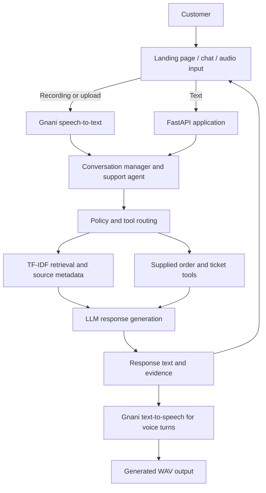

# VoiceOps — ZentroMart AI Customer Support Assistant

An academic capstone prototype for text- and voice-based customer support. VoiceOps combines retrieval-grounded answers, guarded order lookup, support-ticket creation/lookup, and Gnani.ai speech services for the fictional ZentroMart store. All supplied records and the five bundled audio clips are synthetic test material.

> **Verification status (26 October 2026):** The current package-only offline test run completed with **45 passed, 2 skipped, 0 failed**. The two skips require the separately supplied challenge dataset. A retained dataset-configured run recorded successful dataset validation and retrieval Recall@5 of 90% (81/90 gold-evidence identifiers). These results came from separate runs. Live baseline-vs-RAG answer scoring and the 96-turn conversation evaluation remain pending unless rerun with valid local API credentials. The five bundled WAV files are structurally valid audio files, but live Gnani transcription has not been run in this packaging environment. Final microphone-to-audible-playback verification on the target Windows browser remains a manual check.

## Contents

- [Overview and objectives](#overview-and-objectives)
- [Features](#features)
- [Architecture](#architecture)
- [Repository structure](#repository-structure)
- [Requirements](#requirements)
- [Setup](#setup)
- [Dataset and environment configuration](#dataset-and-environment-configuration)
- [Run the web application](#run-the-web-application)
- [Run batch audio processing](#run-batch-audio-processing)
- [Included sample audio](#included-sample-audio)
- [Outputs](#outputs)
- [Testing and evaluation](#testing-and-evaluation)
- [Security, limitations, and future work](#security-limitations-and-future-work)

## Overview and objectives

Conventional support workflows repeatedly handle questions about delivery delays, return rules, order status, refunds, and escalation. The project demonstrates how a shared customer-support agent can respond to those questions through text or audio, retrieve relevant policy evidence, and call the supplied order/ticket tools when appropriate.

The capstone objectives are to:

- answer in-scope questions using retrieved evidence where available;
- keep relevant multi-turn context within a session;
- require order verification before protected order details are returned;
- create and look up synthetic support-ticket records where supported by the supplied tools;
- accept voice recordings through the browser or batch interface and process them using speech-to-text and text-to-speech providers; and
- provide tests and evaluation scripts that distinguish retrieval metrics from generated-answer correctness.

ZentroMart is fictional. The sample audio and course-provided records are intended for software testing, not real customer support.

## Features

- Responsive landing page with separate **Start Voice Support** and **Chat with Support** paths.
- FastAPI web endpoints for text chat, audio, health checks, and session reset.
- Browser microphone recording controls with preview and WAV conversion, plus file upload.
- Batch processing of WAV, MP3, FLAC, M4A, and OGG inputs through `run.py`.
- Gnani.ai STT and TTS adapters; the configured workflow does not silently switch to another speech provider.
- Gemini-compatible LLM access configured using the OpenAI-compatible chat-completions interface.
- TF-IDF/cosine-similarity retrieval over the capstone knowledge base, with source/section metadata and policy precedence.
- Order lookup gated by registered-phone suffix or delivery-pincode verification using the supplied tools.
- Support-ticket creation and read-only lookup against the saved ticket log. Saved tickets do not contain live assignment or resolution updates.
- Automated tests, dataset validation and evaluation scripts.

Features requiring credentials or the challenge dataset cannot operate fully until those dependencies are configured. Passing mocked/offline tests is not evidence of a successful live API call.

## Architecture



The retrieval layer uses lexical TF-IDF vectors and cosine similarity, not a neural dense-embedding model. The browser interface uses `MediaRecorder` and converts the captured browser audio to mono 16-bit PCM WAV before submitting it to the backend. The backend processes audio as **Gnani STT → the same support agent → Gnani TTS**.

## Repository structure

```text
voiceops-zentromart-submission/
├── app.py                       # FastAPI web application
├── run.py                       # Required batch audio runner
├── requirements.txt             # Python dependencies
├── .env.example                 # Safe environment-variable template
├── README.md
├── report.pdf                   # Four-page capstone engineering report
├── src/                          # Agent, retrieval, policy, tools and voice adapters
├── static/                       # Browser JavaScript and CSS
├── templates/                    # Landing page and support interface
├── scripts/                      # Index, evaluation and report scripts
├── tests/                        # Automated unit/integration tests
├── docs/                         # Demo recording guide
├── sample_audio/                 # Five supplied synthetic WAV fixtures + transcripts
├── sample_outputs/               # Retained evaluation snapshots and explanations
├── storage/                      # Local vector index location (generated, ignored)
└── outputs/                      # Runtime result JSON and generated audio (ignored)
```

The course dataset and local `.env` are intentionally not bundled. The source ZIP includes only synthetic sample audio fixtures, not private customer recordings.

## Requirements

- Python 3.12 is recommended for the Windows demo; the current offline packaging checks were run in a Python 3.13.5 environment.
- pip and a virtual environment.
- The VoiceOps 2026 challenge dataset ZIP, obtained from the course, extracted outside version control.
- A Gemini-compatible LLM API key for live response generation.
- A Gnani.ai API key for live STT/TTS processing.
- Network access to the configured external services for live runs.

The declared dependencies are in `requirements.txt`, including FastAPI/Uvicorn, the OpenAI-compatible client, scikit-learn, pandas, joblib, python-dotenv, pytest, and the Gnani speech SDK.

## Setup

### Windows PowerShell

From the extracted project root (the directory containing `run.py` and `app.py`):

```powershell
py -3.12 -m venv .venv
.\.venv\Scripts\Activate.ps1
python -m pip install --upgrade pip
python -m pip install -r requirements.txt
Copy-Item .env.example .env
```

If PowerShell blocks virtual-environment activation, call the interpreter directly instead:

```powershell
.\.venv\Scripts\python.exe -m pip install -r requirements.txt
```

### macOS/Linux

```bash
python3 -m venv .venv
source .venv/bin/activate
python -m pip install --upgrade pip
python -m pip install -r requirements.txt
cp .env.example .env
```

## Dataset and environment configuration

Obtain `Capstone_Project_Dataset_FTTT_2026.zip` from the course and extract it locally. The configured dataset directory must directly contain `kb/`, `data/`, `practice/`, and `tools/tools.py`.

Example PowerShell commands, assuming the dataset ZIP is in the project root:

```powershell
Expand-Archive .\Capstone_Project_Dataset_FTTT_2026.zip -DestinationPath .\dataset
$env:DATASET_DIR = (Resolve-Path .\dataset\Capstone_Project_Dataset_FTTT_2026).Path
python $env:DATASET_DIR\validate_dataset.py
```

Configure `.env` locally using `.env.example` as the starting point. Relevant variables used by `src/config.py` are:

| Variable | Purpose | Required for |
|---|---|---|
| `LLM_API_KEY` | Key for the configured OpenAI-compatible LLM endpoint | Live AI responses and LLM-based evaluations |
| `LLM_MODEL` | Model identifier; `.env.example` sets the Gemini-compatible model | LLM calls |
| `LLM_BASE_URL` | Optional OpenAI-compatible endpoint base URL | Provider-specific endpoint configuration |
| `GNANI_API_KEY` | Gnani speech service credential | Live STT and TTS |
| `GNANI_STT_LANGUAGE` | STT language (example: `en-IN`) | Speech recognition configuration |
| `GNANI_TTS_LANGUAGE` | TTS language (example: `en-IN`) | Speech synthesis configuration |
| `GNANI_TTS_MODEL` | TTS model (example: `timbre-v2.5`) | Speech synthesis configuration |
| `GNANI_TTS_VOICE` | TTS voice (example: `Kaveri`) | Speech synthesis configuration |
| `DATASET_DIR` | Extracted challenge dataset directory, not the ZIP file | RAG and supplied tools |
| `VECTOR_STORE_PATH` | Local persisted retrieval index path | Index storage |
| `LOG_LEVEL` | Logging verbosity | Optional configuration |
| `APP_HOST`, `APP_PORT` | Web server bind host and port values read by settings | Application configuration |

Do not put real credentials in source code, screenshots, reports, Git history, or chat messages. If a key has ever been exposed, revoke or rotate it. Never commit `.env`, the extracted challenge dataset, or private customer data.

Build or refresh the retrieval index from the repository root when needed:

```powershell
python .\scripts\build_index.py
```

The generated index is local and ignored by Git. Rebuild it after changing the knowledge documents or product catalog.

## Run the web application

```powershell
python -m uvicorn app:app --host 127.0.0.1 --port 8000
```

Open <http://127.0.0.1:8000>. The health endpoint is <http://127.0.0.1:8000/health>; it reports configuration readiness but is not proof that upstream services are reachable. The browser voice flow requires microphone permission and a final manual check that the generated audio plays audibly.

## Run batch audio processing

**Exact batch command for submission** (run from the repository root):

```powershell
python run.py --input-dir sample_audio --output-dir outputs
```

Before running, ensure that:

1. Dependencies are installed from `requirements.txt`.
2. `.env` is configured with `LLM_API_KEY`, `GNANI_API_KEY`, and a valid `DATASET_DIR`.
3. The extracted challenge dataset is present at `DATASET_DIR`.
4. The five bundled WAV clips are in `sample_audio/` (they are included in this ZIP).

`run.py` discovers only files whose extensions are `.wav`, `.mp3`, `.flac`, `.m4a`, or `.ogg`. The accompanying `transcripts.txt` and `README.md` are intentionally ignored as unsupported files; they are not submitted to speech recognition. Each supported audio input must be at most 10 MB.

By default, files are processed in sorted filename order and share one conversation session. Because the five clips are independent scenarios, use this optional flag to isolate each clip in its own session if desired:

```powershell
python run.py --input-dir sample_audio --output-dir outputs --new-session-per-file
```

If required credentials or the dataset are missing, the runner writes explicit blocked result records and `batch_summary.json`; it does not create pretend successful transcriptions. Exit codes are `0` when every discovered input succeeds, `1` if processing finishes with failures, and `2` when no supported inputs or required configuration is available.

## Included sample audio

The package includes five short synthetic WAV fixtures and the transcript text file supplied for them. Each WAV was verified as readable mono, 16-bit PCM at 22.05 kHz, and is below 10 MB. The provided transcript text is the intended utterance for each scenario; it has not been independently validated against a live Gnani transcription in this packaging environment.

| File | Scenario | Intended utterance in `sample_audio/transcripts.txt` |
|---|---|---|
| `01_delivery_delay.wav` | Delivery status | “Hello, my order has not arrived yet. Can you check the delivery status?” |
| `02_return_policy.wav` | Damaged item / returns | “I received a damaged product. What is your return and refund policy?” |
| `03_order_lookup.wav` | Order lookup preparation | “I want to check my order. Please tell me what details you need from me.” |
| `04_human_handover.wav` | Human escalation | “I am not satisfied with this resolution. Please connect me to a human support agent.” |
| `05_follow_up.wav` | Refund follow-up | “How long will the refund take after my returned item is approved?” |

These are synthetic test utterances, not real customer recordings. Review outputs against the policy and dataset rather than assuming every generated answer is correct. The batch runner uses the actual recordings and external services when configured; no transcription or response outputs are fabricated in advance.

## Outputs

For each supported input, the runner attempts to generate:

- `outputs/<input-stem>_result.json` — transcript, response text, retrieved-source metadata, tool-call information, decision/status, output audio filename, and a sanitized error field where applicable.
- `outputs/batch_summary.json` — batch status, discovered/processed/succeeded/failed totals, ignored unsupported filenames, and result records.
- `outputs/*_reply.wav` — Gnani-generated speech response when TTS succeeds.

Output filenames for generated audio include a random suffix and may differ each run. The runtime `outputs/` directory is ignored by Git; `outputs/.gitkeep` preserves the directory in the source tree.

## Testing and evaluation

Run the offline test suite:

```powershell
python -m pytest -q
```

To run the two tests that require the supplied dataset, set `DATASET_DIR` in the environment first. The package-only run in this workspace produced **45 passed, 2 skipped, 0 failed**. The skipped tests require the separately supplied dataset.

Other useful commands:

```powershell
# Check Python syntax/compilation
python -m compileall -q app.py run.py src scripts tests

# Retrieval-only measurement (no LLM API key needed)
python scripts/evaluate_questions.py --retrieval-only

# Baseline vs RAG answer evaluation (requires LLM credentials)
python scripts/evaluate_questions.py

# 96-turn conversation evaluation (requires configured dataset and LLM credentials)
python scripts/evaluate_conversations.py
```

Retained evaluation artifacts from a prior dataset-configured run record 81/90 gold evidence identifiers at top five (90% Recall@5) and 47/47 evidence-labeled questions with at least one gold hit. These are retrieval metrics, not proof of answer correctness. Baseline-vs-RAG answer accuracy and live conversation results remain pending until those evaluations are run with valid credentials. A package-only test run is not a live provider test.

## Security, limitations, and future work

- `.env`, the private challenge dataset, local indexes, runtime output audio, logs, virtual environments, and caches are excluded from version control. The five reviewed synthetic sample WAVs are intentionally included; other local recordings remain ignored.
- Order verification and business rules are educational prototype logic, not production-grade authentication. Production use would require real identity controls, HTTPS, rate limiting, secure session storage, and access-control review.
- Session state is in memory; the application does not implement account login or durable conversation storage.
- Ticket creation/lookup reads saved records but does not provide live human-agent assignment or resolution state.
- Live LLM/STT/TTS behavior depends on provider credentials, API availability, network access, and the course dataset. The real microphone flow still needs final target-browser verification, including audible playback.
- Evaluation results must be regenerated against the final code before claiming new baseline/RAG scores or conversation results.

Potential improvements include durable authenticated sessions, production-grade identity verification, live ticket-queue integration, more comprehensive evaluation, and better monitoring. These are future improvements, not claims about the current implementation.

## Project information

- **Project:** VoiceOps — ZentroMart AI Customer Support Assistant
- **Team:** BitBenders
- **Category:** AI-powered customer support / voice agent
- **Repository:** <https://github.com/aayush-as69/voiceops-zentromart>
- **Demo video:** Pending final recording
- **License:** No license is declared in this package. Confirm ownership and course rules before adding one.

The repository should be considered published only after the local Git commit and push succeed and the public repository has been checked while logged out. Do not claim a live demo link until one has been recorded and made accessible.
